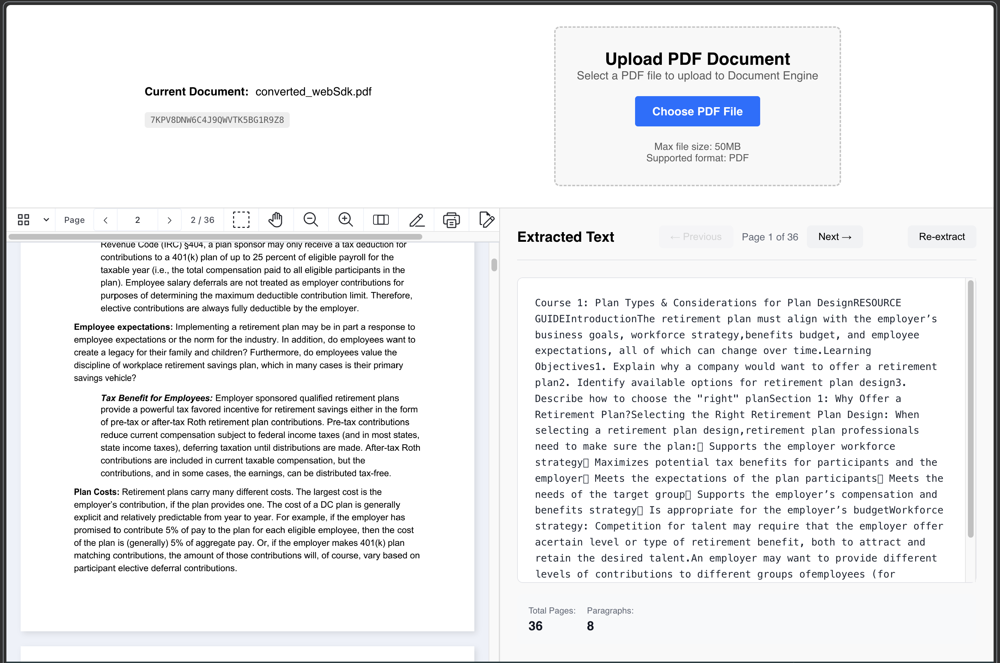

# Text Extract AI

**AI-powered PDF text extraction with Nutrient Web SDK**

A modern web application for viewing PDFs and extracting structured text with AI-powered cleanup. Upload any PDF document and get clean, readable text output with automatic formatting and structure detection.

## 🚀 Live Demo

[**Try it live →**](https://eli7pm.github.io/text-extract-ai/)

## ✨ Features

- **📄 PDF Viewer** - View and navigate PDF documents with Nutrient Web SDK
- **🤖 AI Text Extraction** - Extract text with intelligent formatting cleanup using Claude AI
- **📑 Structure Detection** - Automatically identifies headings, paragraphs, and sections
- **🎨 Clean Interface** - Split-screen view: PDF on left, extracted text on right
- **📱 Responsive Design** - Works on desktop and mobile devices
- **♿ Accessible** - Full ARIA support and semantic HTML
- **⚡ Fast Processing** - Efficient text extraction with pagination

## 🎯 Use Cases

- Extract text from scanned documents (OCR)
- Convert PDFs to clean, readable text
- Get structured content from academic papers
- Process forms and reports
- Extract data for further analysis

## 🛠️ Technology Stack

- **Frontend**: React + Vite
- **PDF SDK**: Nutrient Web SDK (via CDN)
- **UI/UX**: Modern CSS with responsive design
- **Deployment**: GitHub Pages

## 📸 Screenshots



## 🚀 Local Development

Want to run this locally or contribute?

### Prerequisites

- Node.js 18+
- pnpm
- [OrbStack](https://orbstack.dev) with Kubernetes enabled

### Setup

```bash
# Clone the repository
git clone https://github.com/eli7pm/text-extract-ai.git
cd text-extract-ai

# Start Document Engine + backend on local Kubernetes (OrbStack)
./k8s/up.sh

# Install dependencies and start the frontend
pnpm install
pnpm dev
```

Open http://localhost:5173. See [`k8s/README.md`](k8s/README.md) for details on the local stack.

### Build for Production

```bash
pnpm build
```

The built files will be in the `dist/` directory.

## 🔧 Configuration

The app connects to a backend API for document processing. To configure the API URL:

1. Create `.env` file in the project root
2. Set the API URL:
   ```bash
   VITE_API_URL=https://your-api-url.com
   ```

## 🤝 Contributing

Contributions are welcome! Please feel free to submit a Pull Request.

1. Fork the repository
2. Create your feature branch (`git checkout -b feature/AmazingFeature`)
3. Commit your changes (`git commit -m 'Add some AmazingFeature'`)
4. Push to the branch (`git push origin feature/AmazingFeature`)
5. Open a Pull Request

## 📝 License

ISC

## 🙏 Acknowledgments

- [Nutrient Web SDK](https://nutrient.io/) - PDF viewing and processing
- [React](https://react.dev/) - UI framework
- [Vite](https://vitejs.dev/) - Build tool
- [Anthropic Claude](https://anthropic.com/) - AI text cleanup

## 📧 Support

- **Issues**: [GitHub Issues](https://github.com/eli7pm/text-extract-ai/issues)
- **Discussions**: [GitHub Discussions](https://github.com/eli7pm/text-extract-ai/discussions)

---

Made with ❤️

**Star ⭐ this repo if you find it useful!**
